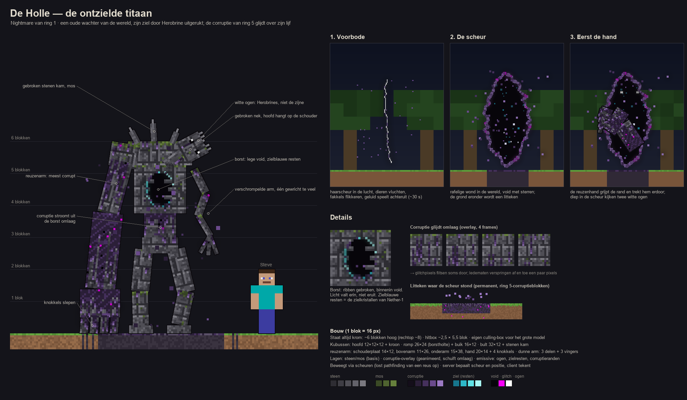

# Fase 4 — Nightmares (concept)

**Status:** concept uit een vooruitblik-sparring (2026-10-20). Er wordt niets gebouwd vóór fase 4; de fase 4-sparring maakt dit definitief. Scope: `mobs`.

## Idee
Een groep **Nightmares**: één per ring (5 totaal), groter dan gewone mobs, bedoeld om kippenvel te geven. Rondzwervende overworld-ringbosses, ingezet vanuit Herobrines legioen.

- **Rolverdeling:** bewakers zijn *poortwachters op een vaste plek* (jij gaat naar hen toe); Nightmares zijn *dreiging die jou vindt*. Herobrine blijft de enige die "persoonlijk" is.
- **Rode draad:** Herobrines witte ogen als handtekening van het legioen. Elke Nightmare geeft betekenis aan iets wat fase 1 al in de wereld heeft gelegd.

## Beslissingen (sparring 2026-10-20)
1. **Los en optioneel** t.o.v. de bewakers: verslaan levert iets waardevols op, maar is geen progressie-eis.
2. **Eén unieke Nightmare per ring per server.** De server houdt een virtuele positie bij (`SavedData`) en laat hem bij spelers in zijn ring verschijnen; ook als zijn chunks niet geladen zijn, "bestaat" hij.
3. **Komt sterker terug** na verslaan (timer en/of gekoppeld aan wereldcorruptie, fase 5).
4. **Ring 1: volwaardig bossgevecht.** De Holle valt ook bovengronds actief aan; de stalk-opbouw blijft als aanloop.

## Rooster (werktitels, ter discussie)
| Ring | Nightmare | Haak in de bestaande wereld |
|---|---|---|
| 1 | **De Holle** (The Hollow) — ontzielde titaan, dimension shifter | corruptie van ring 5 in de vanilla-ring; zielkristallen van Nether-1 |
| 2 | **De Luchtspiegeling** — gestalte in de hittetrilling | fata morgana, oases met villagers, uitdroging |
| 3 | **Het Askoor** — reus van samengesmolten as-afgietsels | as-afgietsels, lavabuizen, gestolen water |
| 4 | **Wat onder de bellen leeft** | backlog: "iets groots onder water (bij de bellen)", het silhouet is de voorbode |
| 5 | **De Onvoltooide** — half geladen, glitchende wachter | void, glitches, kastelen (niet overlappen met "beweegt als je niet kijkt") |

## Ring 1 — De Holle, de ontzielde titaan (werktitel)
*Herontwerp 2026-10-20: vervangt de eerste schets (uitgerekte nabootser). "Hol" betekent nu: zonder ziel.*

**Wie hij was:** een oude wachter van de overworld, een stenen titaan. Herobrine rukte zijn ziel uit en maakte hem tot dimension shifter van zijn legioen. Daarom loopt er iets corrupts in de vanilla-ring: hij hoort er niet, hij komt via een scheur uit Herobrines domein.

**Gedaante (~6 blokken, altijd krom; rechtop ~8):**
- Lijf van gebarsten steen- en deepslate-platen met mos (knieën, schouders, bult). Over de rug loopt een gebroken stenen kam.
- **Asymmetrisch:** zijn rechterarm is gezwollen en reusachtig, met knokkels die over de grond slepen. Die arm is het meest corrupt, omdat hij als eerste door de scheur komt. De linkerarm is verschrompeld en heeft een gewricht te veel.
- **Gebroken nek:** het hoofd (stenen schedel met gebroken kroon) hangt op zijn linkerschouder. De oogkassen zijn leeg, op twee witte pixels na: dat zijn Herobrines ogen, niet de zijne. Uit één oogkas loopt een corruptietraan.
- **Borst:** een opengebroken ribbenkooi met daarin pure void. Licht valt erin en niet eruit. Op de rand zitten zielblauwe resten in het palet van de zielkristallen.
- **Corruptie:** de corruptie van ring 5 (grijsviolet, void-zwart, glitchpixels) glijdt als een vloeistof over zijn lijf. Ze stroomt uit de borst omlaag en ligt het dikst op de reuzenarm. Af en toe verspringt een ledemaat een paar pixels, alsof hij niet helemaal in deze dimensie zit.

**Zijn ziel:** die is versplinterd tot de **zielkristallen van Nether-ring 1** (beslissing 2026-10-20). Later (fase 2) wordt dat ook een zwakte: een zielkristal-item laat hem verstijven of houdt hem "in fase".

**De komst (dimensiescheur):**
1. *Voorbode (~30 s):* er verschijnt een haarscheur in de lucht. Dieren vluchten, fakkels flikkeren en geluiden spelen achteruit.
2. *De scheur:* een rafelige verticale wond (~3 × 7 blokken) met een void vol sterren (render zoals het End-portaal) en corrupte, gloeiende randen.
3. *Eerst de hand:* de reuzenhand grijpt de rand en trekt hem erdoor. Diep in de scheur kijken twee witte ogen.
4. *Litteken:* waar de scheur stond blijft een **klein permanent litteken** van ring 5-corruptieblokken achter (beslissing 2026-10-20). Het genees-/vervalgedrag volgt in fase 5.

**Gevecht (volwaardig, ook bovengronds):**
- *Verspringen:* hij stapt een scheur in en komt achter je weer naar buiten. Een krakend geluid waarschuwt je vooraf.
- *Uit fase:* delen van zijn lijf zijn soms doorzichtig en dan onkwetsbaar. Je moet slaan als hij volledig "hier" is.
- *Zuigkracht:* een open scheur trekt spelers en items naar zich toe.
- *Wisselen:* hij verwisselt twee spelers van plek (multiplayer).
- *Aftocht:* bij een schadedrempel (of bij zonsopgang, nog open) valt hij achterover zijn scheur in. Daarna komt hij sterker terug.

**Bouw (1 blok = 16 px):**
- **Hitbox:** ~2,5 × 5,5 blok. Het model heeft een eigen culling-box nodig, omdat het groter is dan de hitbox.
- **Romp:** hoofd 12×12×12 + kroon · romp 26×24 (borstholte) + buik 16×12 · bult 32×12 + stenen kam.
- **Reuzenarm:** schouderplaat 14×12, bovenarm 11×26, onderarm 15×38, hand 20×14 + 4 knokkels.
- **Dunne arm:** 3 delen + 3 vingers.
- **Lagen:** steen/mos (basis) · geanimeerde corruptie-overlay die omlaag schuift · emissive laag (ogen, zielresten, corruptieranden).
- **Paletten:** steen `2E2D33 3E3D44 4F4E55 63626A 7A7980` · mos `3B4A26 4F6330 66803C` · corruptie `140E1A 2B1F38 45305C 6A4A8C 9C7AC4` · ziel `17758C 2DB8C8 5FE3E6 A8F7F4` (= zielkristal) · void `07050A` · glitch `F800F8`.
- **Beweging en techniek:** hij beweegt via scheuren, wat het pathfinding-probleem van een reus oplost. De scheur is een eigen entity: de server bepaalt positie en levensduur, de client tekent hem.

## Haalbaarheid in 1.21.1 / NeoForge
- **Goed te doen:** grote modellen (4–6 blokken), bossbar (`ServerBossEvent`, multiplayer-proof), eigen AI-goals, positionele geluiden server-side (vanilla-events met pitch, zoals change 32), particles en client-effecten via payload.
- **Lastig maar haalbaar:** pathfinding van grote mobs (vanilla-navigatie loopt vast in bossen en grotten → hitbox kleiner dan het model, of eigen beweging: kruipen, graven, zwemmen); de unieke, persistente Nightmare (virtuele positie in `SavedData`, pas materialiseren bij spelers); houdingwissel met hitbox (kruiphouding, zoals een zwemmende speler) plus eigen navigatie door 1×2.
- **Af te raden:** per-speler hallucinaties met één gedeelde entity (vereist client-only nep-entities); zware render-glitches/shaders (ring 5) → houd het bij model-swaps, stotter-teleports en geluid.
- **Client/server:** alle logica (positie, AI, aanvallen, fakkels doven, terugkeertimer) server-side; de client toont alleen model, animatie en effecten.

## Open voor de fase 4-sparring
- Balans van het ring 1-gevecht met ring 1-gear (ijzer/diamant): HP, schade, schaal met het aantal spelers.
- Terugkeer: interval, hoeveel sterker, wat er verandert (nieuwe aanval of fase).
- Beloning/drop per Nightmare (waardevol, niet verplicht).
- Zonsopgang: trekt hij zich terug of vecht hij door?
- Wat doet hij buiten het gevecht (stalken via haarscheuren? alleen komen bij nacht?).
- Blijft er een link met de 2×1-tunnels en kale plekken van ring 1, of horen die bij iets anders?
- Animatietechniek: GeckoLib (dependency, makkelijke complexe animaties) of vanilla keyframe-animaties (geen dependency, meer werk).
- Concepten ring 2–5 uitwerken; Nightmares in de Nether-ringen (ja/nee).
