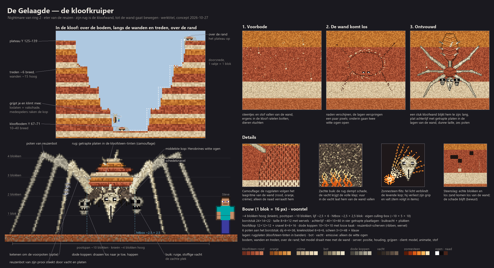
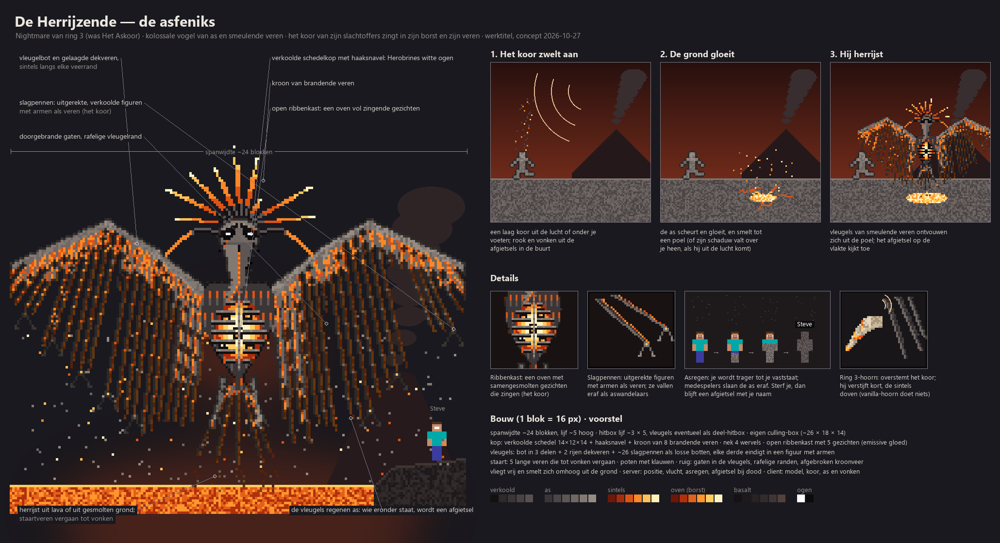
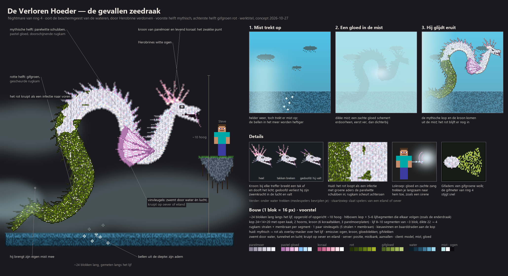
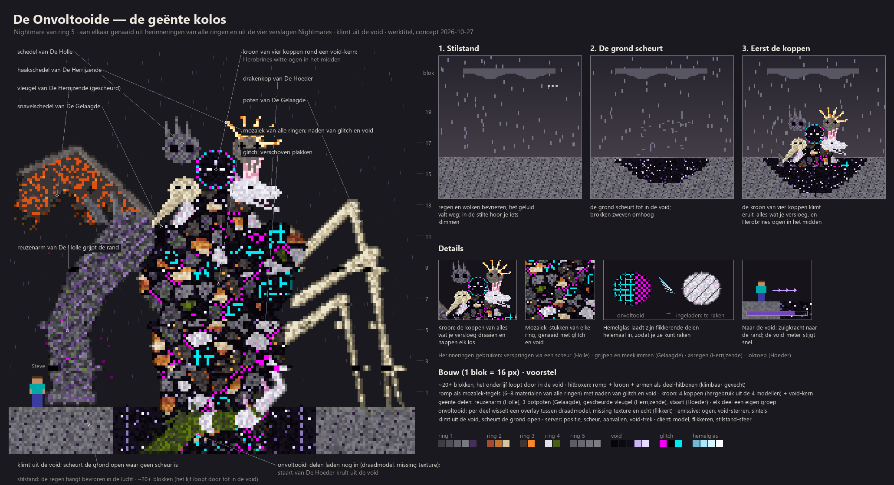

# Fase 4 — Nightmares (concept)

**Status:** concept uit een vooruitblik-sparring (2026-10-20); De Holle definitief gemaakt in de fase 4-sparring van 2026-10-28 (zie zijn sectie). Er wordt niets gebouwd vóór fase 4; de fase 4-sparring maakt dit definitief. Scope: `mobs`.

## Idee
Een groep **Nightmares**: één per ring (5 totaal), groter dan gewone mobs, bedoeld om kippenvel te geven. Rondzwervende overworld-ringbosses, ingezet vanuit Herobrines legioen.

- **Rolverdeling:** bewakers zijn *poortwachters op een vaste plek* (jij gaat naar hen toe); Nightmares zijn *dreiging die jou vindt*. Herobrine blijft de enige die "persoonlijk" is.
- **Rode draad:** Herobrines witte ogen als handtekening van het legioen. Elke Nightmare geeft betekenis aan iets wat fase 1 al in de wereld heeft gelegd.
- **Art direction (2026-10-27):** ruig en boss-waardig, niveau Elden Ring. Gebroken silhouetten (geen kale blokken), gelaagde platen en richels, asymmetrie en schade (afgebroken hoorns, littekens, gescheurde vliezen, bloot bot), zware wenkbrauwen en diepe oogkassen, veel tanden, een dreigende houding en textures met sterk contrast, vuil en slijtage. Nooit schattig, schoon of speelgoedachtig. Geldt voor alle Nightmares, hun platen en hun modellen.

## Beslissingen (sparring 2026-10-20)
1. **Los en optioneel** t.o.v. de bewakers: verslaan levert iets waardevols op, maar is geen progressie-eis.
2. **Eén unieke Nightmare per ring per server.** De server houdt een virtuele positie bij (`SavedData`) en laat hem bij spelers in zijn ring verschijnen; ook als zijn chunks niet geladen zijn, "bestaat" hij.
3. **Komt sterker terug** na verslaan (timer en/of gekoppeld aan wereldcorruptie, fase 5).
4. **Ring 1: volwaardig bossgevecht.** De Holle valt ook bovengronds actief aan; de stalk-opbouw blijft als aanloop.

## Rooster (werktitels, ter discussie)
| Ring | Nightmare | Haak in de bestaande wereld |
|---|---|---|
| 1 | **De Holle** (The Hollow) — ontzielde titaan, dimension shifter | corruptie van ring 5 in de vanilla-ring; zielkristallen van Nether-1 |
| 2 | **De Gelaagde** (The Layered; was "De Luchtspiegeling") — veelkoppige kloofkruiper, eter van de reuzen | kloven, half begraven reuzenskeletten in de duinenzee |
| 3 | **De Herrijzende** (The Risen; was "Het Askoor") — kolossale asfeniks met een koor van slachtoffers in zijn borst en veren | as-afgietsels, voetsporen in de as, lava en vulkanen |
| 4 | **De Verloren Hoeder** (The Lost Keeper; was "Wat onder de bellen leeft") — gevallen mythische zeedraak, half parelwit, half gifgroen rot | bellen, het silhouet onder water, mist, zwevende eilanden, de zeewezen-fossielen van Nether-4 |
| 5 | **De Onvoltooide** — kolossaal geënt mozaïek van herinneringen en van de vier verslagen Nightmares, klimt uit de void | herinneringen, void-scheuren, glitchblokken, stilstand-weer |

## Fase 4-sparring alle Nightmares (2026-10-28)
- **Omvang:** alle vijf eerst tot stap 1 (lijf + gevecht, op te roepen met `/summon`). Daarna komt stap 2+3 (komst, rondzwerven, aftocht, terugkeer) één keer als gedeeld systeem voor alle vijf.
- **Gedeelde regels (die van De Holle), oplopend per ring:** HP 300 / 450 / 600 / 800 / 1200 (ring 1–5), +50% per extra speler in de buurt, 0 HP = verslagen, iedereen weg/dood = terugtrekken + genezen, terugkeer na 3 ingame-dagen met +25% (max. 3×). Beloning: XP plus het materiaal van zijn ring (ring 1 zielkristal/diamant, ring 2 zonnesteen, ring 3 vulkaniet, ring 4 getijdezilver, ring 5 nulliet); unieke items later. Alle getallen in de config.
- **Zwaktes met een item worden nu volledig gemaakt** (categorie `items`, eigen stroom): de zonnesteen-flits (ring 2) en de versterkte ring 3-hoorn. Ring 5 gebruikt de bestaande hemelglaslens uit fase 2: kijk je erdoor, dan "laden" zijn onvoltooide delen in.
- **Overige open punten per ring** (gedrag buiten het gevecht, mistgrootte, lokroep, teruggroeiende kroon, wegvallende delen enz.): de bouwstromen kiezen een voorlopige invulling, die de gebruiker bij de teststop bevestigt (zoals in fase 2).

## Ring 1 — De Holle, de ontzielde titaan (werktitel)
*Herontwerp 2026-10-20: vervangt de eerste schets (uitgerekte nabootser). "Hol" betekent nu: zonder ziel.*

**Wie hij was:** een oude wachter van de overworld, een stenen titaan. Herobrine rukte zijn ziel uit en maakte hem tot dimension shifter van zijn legioen. Daarom loopt er iets corrupts in de vanilla-ring: hij hoort er niet, hij komt via een scheur uit Herobrines domein.

**Gedaante (~6 blokken, altijd krom; rechtop ~8):**
- Lijf van gebarsten steen- en deepslate-platen met mos (knieën, schouders, bult). Over de rug loopt een gebroken stenen kam.
- **Asymmetrisch:** zijn rechterarm is gezwollen en reusachtig, met knokkels die over de grond slepen. Die arm is het meest corrupt, omdat hij als eerste door de scheur komt. De linkerarm is verschrompeld en heeft een gewricht te veel.
- **Gebroken nek:** het hoofd (stenen schedel met gebroken kroon) hangt op zijn linkerschouder. De oogkassen zijn leeg, op twee witte pixels na: dat zijn Herobrines ogen, niet de zijne. Uit één oogkas loopt een corruptietraan.
- **Borst:** een opengebroken ribbenkooi met daarin pure void. Licht valt erin en niet eruit. Op de rand zitten zielblauwe resten in het palet van de zielkristallen.
- **Corruptie:** de corruptie van ring 5 (grijsviolet, void-zwart, glitchpixels) glijdt als een vloeistof over zijn lijf. Ze stroomt uit de borst omlaag en ligt het dikst op de reuzenarm. Af en toe verspringt een ledemaat een paar pixels, alsof hij niet helemaal in deze dimensie zit.

**Zijn ziel:** die is versplinterd tot de **zielkristallen van Nether-ring 1** (beslissing 2026-10-20). Later (fase 2) wordt dat ook een zwakte: een zielkristal-item laat hem verstijven of houdt hem "in fase".

**De komst (dimensiescheur):**
1. *Voorbode (~30 s):* er verschijnt een haarscheur in de lucht. Dieren vluchten, fakkels flikkeren en geluiden spelen achteruit.
2. *De scheur:* een rafelige verticale wond (~3 × 7 blokken) met een void vol sterren (render zoals het End-portaal) en corrupte, gloeiende randen.
3. *Eerst de hand:* de reuzenhand grijpt de rand en trekt hem erdoor. Diep in de scheur kijken twee witte ogen.
4. *Litteken:* waar de scheur stond blijft een **klein permanent litteken** van ring 5-corruptieblokken achter (beslissing 2026-10-20). Het genees-/vervalgedrag volgt in fase 5.

**Gevecht (volwaardig, ook bovengronds):**
- *Verspringen:* hij stapt een scheur in en komt achter je weer naar buiten. Een krakend geluid waarschuwt je vooraf.
- *Uit fase:* delen van zijn lijf zijn soms doorzichtig en dan onkwetsbaar. Je moet slaan als hij volledig "hier" is.
- *Zuigkracht:* een open scheur trekt spelers en items naar zich toe.
- *Wisselen:* hij verwisselt twee spelers van plek (multiplayer).
- *Aftocht:* bij een schadedrempel (of bij zonsopgang, nog open) valt hij achterover zijn scheur in. Daarna komt hij sterker terug.

**Bouw (1 blok = 16 px):**
- **Hitbox:** ~2,5 × 5,5 blok. Het model heeft een eigen culling-box nodig, omdat het groter is dan de hitbox.
- **Romp:** hoofd 12×12×12 + kroon · romp 26×24 (borstholte) + buik 16×12 · bult 32×12 + stenen kam.
- **Reuzenarm:** schouderplaat 14×12, bovenarm 11×26, onderarm 15×38, hand 20×14 + 4 knokkels.
- **Dunne arm:** 3 delen + 3 vingers.
- **Lagen:** steen/mos (basis) · geanimeerde corruptie-overlay die omlaag schuift · emissive laag (ogen, zielresten, corruptieranden).
- **Paletten:** steen `2E2D33 3E3D44 4F4E55 63626A 7A7980` · mos `3B4A26 4F6330 66803C` · corruptie `140E1A 2B1F38 45305C 6A4A8C 9C7AC4` · ziel `17758C 2DB8C8 5FE3E6 A8F7F4` (= zielkristal) · void `07050A` · glitch `F800F8`.
- **Beweging en techniek:** hij beweegt via scheuren, wat het pathfinding-probleem van een reus oplost. De scheur is een eigen entity: de server bepaalt positie en levensduur, de client tekent hem.

### Fase 4-sparring De Holle (2026-10-28) — definitief
- **Animatie:** GeckoLib (voor alle vijf Nightmares). Dependency op client én server.
- **Bouwvolgorde (stap-voor-stap):** stap 1 = lijf + gevecht (entity, model, textures, animaties, bossbar, aanvallen; op te roepen met `/summon`). Stap 2 = de scheur en de komst (voorbode, scheur-entity, zuigkracht, litteken). Stap 3 = rondzwerven (virtuele positie in `SavedData`), aftocht, terugkeer.
- **Balans:** 300 HP (zoals de Wither), +50% HP per extra speler in de buurt; de reuzenarm slaat ~10 (5 harten). Getallen in de config.
- **Wanneer:** **altijd**, dag en nacht; zonsopgang doet niets. Ring 1 is nergens echt veilig.
- **Verslaan:** op 0 HP valt hij achterover zijn scheur in (= verslagen, beloning, terugkeertimer start). Sterven alle spelers in de buurt of lopen ze weg, dan trekt hij zich terug zonder beloning en geneest hij.
- **Terugkeer:** na **3 ingame-dagen** kan hij weer komen, met +25% HP en schade per keer, tot maximaal 3 keer. In fase 5 kan de corruptie dit versnellen. Getallen in de config.
- **Beloning:** voorlopig vanilla: veel XP, zielkristallen en een paar diamanten. Een uniek item (zoals zijn void-hart) komt later in `items` (backlog).
- **Zwakte (zielkristal):** sla je hem met een zielkristal in je hand, dan is hij 4 s "vastgepind in fase": hij verspringt niet en is niet doorzichtig. Dit kost 1 kristal (in creative niet).

## Ring 2 — De Gelaagde (The Layered), de kloofkruiper (werktitel)
*Sparring 2026-10-27, op basis van twee referentiebeelden van de gebruiker (een spinachtig kloofbeest en een driekoppige hellehond). Het zijn inspiratiebronnen, geen kopie.*

- **Lijf:** de basis is een kloofkruiper: veel te lange poten en een zwaar lijf. Hij heeft **2–3 schedelkoppen**; alleen de middelste heeft Herobrines witte ogen. Ketenen om de voorpoten zijn een optie.
- **Materiaal (camouflage):** zijn rug bestaat uit platen in de drie kloofsteen-tinten (rood, oranje, crème, in banden zoals de wand), zodat hij tegen de wand bijna onzichtbaar is. De poten zijn van reuzenbot, de buik is ruige, stoffige vacht.
- **Lijfvorm (uitgemergeld en getrapt):** een smal borststuk met de koppen en de zes poten, een dunne taille met zichtbare ruggengraat en een lang, plat achterlijf (~2,5 breed × ~6 lang). De platen op het achterlijf liggen getrapt, zoals de treden van de kloof: zijn rug is een kleine kloofwand. Omdat hij plat is, ligt hij strak tegen de wand, zonder schaduw die hem verraadt.
- **Prooi in het lijf:** uit de vachtbuik en tussen de rugplaten steken gebroken reuzenbotten (ribben, een wervel) van de reuzen die hij at.
- **Dode koppen:** ze zijn dood, maar bewegen toch. Ze draaien los van elkaar naar de speler en happen af en toe. Waar ze vandaan komen is nog open.
- **Komst (de wand komt los):** als voorbode vallen er steentjes en stof van de wand, ratelen er ergens in de kloof botten en vluchten de dieren. Daarna ontvouwt zich een stuk kloofwand: dat is hij.
- **Aanvallen:**
  - *Grijpen en meeklimmen:* hij grijpt een speler en klimt met hem de wand op; laat hij los, dan volgt valschade. Andere spelers bevrijden de speler door de kop te raken.
  - *Steenslag en los zand:* vanaf de wand maakt hij stenen en `loose_sand` boven de speler los. Dit zijn echte blokken en de schade is **blijvend**. Bewust geaccepteerd: het kan bases en terrein beschadigen.
- **Formaat:** ~4 blokken hoog, poten ~10 breed. De hitbox is kleiner (~2,5 × 2,5) en het model krijgt een eigen culling-box.
- **Zwakte (twee lagen):**
  - *Pantserrug, zachte buik:* de stenen rug dempt schade, de vachtbuik krijgt de volle klap. Kruipt hij boven je over een wand of overhang, dan ligt de buik open. Vuur in zijn vacht laat hem van de wand vallen.
  - *Zonnesteen-flits:* fel zonnesteenlicht verblindt de levende kop, waardoor hij zijn grip verliest en valt. Hier is een item of effect voor nodig in `items` (backlog).

**Open (ring 2):** waar de dode koppen vandaan komen; gedrag buiten het gevecht en aftocht; terugkeer; beloning; balans met ring 2-gear (zonnesteen); hoe de blijvende steenslag begrensd wordt (aantal blokken, niet bij spelerbouwsels?).
- **Verhaal:** hij is de **eter van de reuzen**. De half begraven reuzenskeletten in de duinenzee (blikvanger `dune_sea`) zijn zijn prooi.
- **Beweging:** over de kloofbodem én langs wanden en treden, en over de rand het plateau op. Bij de kloof ben je nergens veilig. Het model draait mee met de wand: de client rendert het, de server bepaalt de staat.
- **Zwakte:** vrij te kiezen (geen vast patroon per Nether-ring); nog open.

## Ring 3 — De Herrijzende (The Risen, werktitel; was Het Askoor)
*Sparring 2026-10-27. Eerste versie was een vormeloze massa van afgietsels ("Het Askoor"); na het Blockbench-model vond de gebruiker dat komisch in plaats van eng. Herzien naar een mythisch wezen met een sterk silhouet. Verhaal, koor, lava, afgietsel bij dood en de hoorn zijn gebleven.*

- **Wie hij is:** een reusachtige **asfeniks**, een vogel van as en smeulende veren met een uitgemergelde, half verkoolde schedelkop en Herobrines witte ogen. Een feniks herrijst uit zijn as: zijn terugkeer na verslaan (algemene Nightmare-regel) is hier mythe, geen regel.
- **Haak in de wereld:** elk as-afgietsel in ring 3 (die allemaal naar de dichtstbijzijnde vulkaan kijken) is iemand die hij verbrandde. De voetsporen in de as die abrupt stoppen of bij een kraterrand eindigen, zijn mensen die hij meenam.
- **Het koor (zijn slachtoffers):** zijn borst is een **open ribbenkast die gloeit als een oven**, vol samengesmolten gezichten die zingen. Ook zijn **slagpennen** zijn uitgerekte, verkoolde figuren met armen als veren; als hij vliegt, zie je ze bewegen.
- **Formaat:** kolossaal, **spanwijdte ~24**, van ver te zien boven de vulkanen.
- **Beweging:** hij **vliegt** vrij over heel ring 3 én kan zich **overal omhoog smelten**. Lava en vulkaankraters zijn zijn nest: daar rust hij en daar herrijst hij.
  - *Omhoog smelten:* hij reist onder de grond (virtuele positie; de lavabuizen geven het verhaal). De grond gloeit en scheurt, en smelt tot een tijdelijke lavapoel (~5–7 breed) waar hij uit oprijst. Lava ligt maar op ~1,6 % van het oppervlak; zo komt hij ook waar geen lava is.
  - *Litteken:* na afloop stolt de poel tot een blijvende plek van basalt, magma en obsidiaan, net als het litteken van De Holle. Alleen natuurlijke blokken, nooit spelersblokken; de fase 1-regel "geen lava tegen open lucht" blijft heel.
- **Komst (het koor zwelt aan):** eerst hoor je een laag koor, steeds luider, uit de lucht of onder je voeten. Uit de afgietsels in de buurt stijgen rook en vonken op (particles). Dan valt zijn schaduw over je heen, of gloeit en smelt de grond en rijst hij op.
- **Aanvallen:**
  - *Tot afgietsel maken:* zijn vleugels laten as regenen die je bedekt; je wordt steeds trager tot je vaststaat. Medespelers kunnen de as eraf slaan. Sterf je zo, dan blijft er een afgietsel in jouw houding achter (zie hieronder).
  - *Koorschreeuw:* zijn kreet met alle stemmen van het koor tegelijk: misselijkheid of zwakte in een straal, en dieren en mobs vluchten.
  - *Slachtoffers loslaten:* figuren vallen uit zijn veren en gaan als aswandelaars lopen (de gewone ring 3-mobs uit de backlog; afstemmen in fase 4).
- **Zwakte (ring 3-hoorn):** een eigen, versterkte ring 3-hoorn overstemt het koor en laat hem kort verstijven; de vanilla-geitenhoorn doet niets. De basis is een geitenhoorn, en geiten leven in ring 3 alleen op de pieken. Het recept volgt in `items` (backlog).
- **Afgietsel bij je dood:** blijvend, in jouw houding (as- en smeulende-asblokken), met je naam zichtbaar als iemand ernaar kijkt (klein block entity). Alleen op vrije ruimte, nooit over spelersblokken.
- **Techniek (eerste inschatting):** vliegende boss met eigen vlucht-AI (zoals de enderdraak); grote vleugels met slagpennen als losse botten voor de animatie (GeckoLib ligt voor de hand, nog open); een hitbox op het lijf, de vleugels mogelijk als deel-hitbox.

**Open (ring 3):** gedrag buiten het gevecht (cirkelt hij boven vulkanen?); hoe lang hij op de grond komt en of je hem omlaag moet halen; aftocht en terugkeer; beloning; balans met ring 3-gear (vulkaniet); de precieze werking van het verstijven (valt hij uit de lucht?).

## Ring 4 — De Verloren Hoeder (The Lost Keeper, werktitel)
*Sparring 2026-10-27. Vervangt de werktitel "Wat onder de bellen leeft".*

- **Wie hij was:** de beschermgeest van de wateren van ring 4, een mythische zeedraak. Herobrine verdorf hem. Zijn **voorste helft is nog mythisch** (parelwitte schubben, pastel gloed), zijn **achterste helft is gifgroen rot**: hij is het verloop van de ring zelf, van mythisch naar bedorven. Hij is de eerste Nightmare die je eerst prachtig vindt.
- **Haak in de wereld:** de bellenstromen uit de diepte zijn zijn adem en het silhouet onder water (fase 1) is hij. De fossiele ribbenkasten van reusachtige zeewezens in Nether-4 zijn zijn dode soortgenoten.
- **Gedaante (herzien 2026-10-27 na referentiebeelden; vervangt "zeedraak met flippers"):** een **lange zeeslang-draak** van ~24 blokken die kronkelt en lussen maakt; opgericht of opgerold ~10 hoog. **Volledig zichtbaar**; hij kan ook op een oever of eiland kruipen. Hij heeft een **gehoornde drakenkop met open muil**, een **rugkam van stekelige vinstralen** met membraan over de hele lengte, en **één paar grote, doorschijnende vinvleugels** bij de kop. In de mythische helft zijn de vinnen pastel-lila en doorschijnend, in de rotte helft gescheurd en groen verkleurd. Technisch: een kop-hitbox plus 5–6 lijfsegmenten die elkaar volgen (zoals de enderdraak).
- **Beweging:** door water en door het tunnelnet, en hij **zwemt ook door de lucht** tussen de zwevende eilanden, alsof het water is. Zo komt hij overal in ring 4.
- **Komst (uit de mist):** hij **brengt zijn eigen dikke mist mee**, ook bij helder weer (lokaal rond hem; server-staat en sync, zoals het ringweer). Mist die in helder weer optrekt, voorspelt hem. Zijn gloed schemert door de mist, eerst ver weg en dan steeds dichterbij.
- **Aanvallen:**
  - *Lokroep (mythische helft):* zijn gloed en een zachte zang trekken spelers langzaam naar hem toe, zoals een sirene.
  - *Gifadem (rotte helft):* een gifgroene wolk; de gifmeter van ring 4 stijgt snel.
  - *Onder water trekken:* hij slaat zijn lijf om een speler en trekt die onder water; medespelers bevrijden je.
  - *Van het eiland slaan:* een staartzwiep langs een eiland of oever slaat spelers eraf (valschade of het water in).
- **Zwakte (de kroon):** een kroon van gloeiend parelmoer en levend koraal die tussen en achter zijn hoorns groeit, het mooiste deel van de mythische helft. Bij elke treffer breekt er een tak af en dooft het licht. Raak hem daar en hij verliest zijn zwemkracht in de lucht en valt.

**Open (ring 4):** hoe groot de mistbank is en hoe lang die blijft; de lokroep precies (kracht, hoe je je verzet); of de kroon na zijn terugkeer teruggroeit; balans met ring 4-gear (getijdezilver); de link met de mist-mobs uit de backlog.

## Ring 5 — De Onvoltooide (The Unfinished, werktitel)
*Sparring 2026-10-27. De laatste Nightmare vóór Herobrine: de zwaarste, en de finale van de hele reis.*

- **Wie hij is:** een **geënte kolos**, aan elkaar genaaid uit brokken van alle ringen én van de vier verslagen Nightmares: de reuzenarm van De Holle, poten van De Gelaagde, een vleugel van De Herrijzende, de staart van De Hoeder. De naden zijn glitch en void. Hij is **onvoltooid**: delen laden nog in, flikkeren (draadmodel, missing texture) of ontbreken.
- **Haak in de wereld:** de "herinneringen" in ring 5 (vervormde brokken van ring 1–4, soms zwevend of scheef) zijn brokken die van hem afvallen.
- **Kop (kroon van vier koppen):** rond een lege void-kern met Herobrines witte ogen zitten de koppen van de vier verslagen Nightmares aan elkaar geënt: de schedel van De Holle, de snavelschedel van De Gelaagde, de haakschedel van De Herrijzende en de drakenkop van De Hoeder. Ze draaien en happen elk los.
- **Formaat:** kolossaal, **~20+ blokken**. Het gevecht wordt vooral klimmen en zwakke plekken raken, op een brok, een brug of een kasteelplateau.
- **Beweging:** hij leeft in de void en **klimt via scheuren en randen omhoog**. Waar geen scheur is (de binnenband), **scheurt hij de grond open** tot in de void en klimt eruit. Er blijft een blijvende void-scheur achter (alleen natuurlijke blokken), net als de littekens van De Holle en De Herrijzende.
- **Komst (stilstand):** het ringweer "stilstand" valt in: regen en wolken bevriezen en het geluid valt weg. In die stilte hoor je hem klimmen.
- **Aanvallen:**
  - *Herinneringen gebruiken:* via zijn geënte delen gebruikt hij een aanval van elke eerdere Nightmare: verspringen via een scheur (De Holle), grijpen en meeklimmen (De Gelaagde), asregen (De Herrijzende), lokroep (De Hoeder).
  - *Naar de void trekken:* een zuigkracht naar de dichtstbijzijnde void-rand; je void-meter stijgt snel.
- **Zwakte (hemelglas):** hemelglas (het sleutelmateriaal van Nether-4, tegengif tegen void en glitches) "laadt" zijn flikkerende, onvoltooide delen helemaal in, zodat ze te raken zijn. De vorm (pijlen, een lens, een coating) volgt in `items` (backlog).
- **Grens met andere ontwerpen:** hij beweegt niet "als je niet kijkt" (dat blijft voor de schaduw-mobs van ring 5) en is niet persoonlijk; dat blijft Herobrine.

**Open (ring 5):** of losgeslagen of uitgeschakelde delen tijdens het gevecht wegvallen; wat er gebeurt als hij terugkeert (nieuwe herinneringen erbij?); de rol van de kastelen; balans met ring 5-gear (nulliet); beloning.

## Haalbaarheid in 1.21.1 / NeoForge
- **Goed te doen:** grote modellen (4–6 blokken), bossbar (`ServerBossEvent`, multiplayer-proof), eigen AI-goals, positionele geluiden server-side (vanilla-events met pitch, zoals change 32), particles en client-effecten via payload.
- **Lastig maar haalbaar:** pathfinding van grote mobs (vanilla-navigatie loopt vast in bossen en grotten → hitbox kleiner dan het model, of eigen beweging: kruipen, graven, zwemmen); de unieke, persistente Nightmare (virtuele positie in `SavedData`, pas materialiseren bij spelers); houdingwissel met hitbox (kruiphouding, zoals een zwemmende speler) plus eigen navigatie door 1×2.
- **Af te raden:** per-speler hallucinaties met één gedeelde entity (vereist client-only nep-entities); zware render-glitches/shaders (ring 5) → houd het bij model-swaps, stotter-teleports en geluid.
- **Client/server:** alle logica (positie, AI, aanvallen, fakkels doven, terugkeertimer) server-side; de client toont alleen model, animatie en effecten.

## Open voor de fase 4-sparring
- Balans van het ring 1-gevecht met ring 1-gear (ijzer/diamant): HP, schade, schaal met het aantal spelers.
- Terugkeer: interval, hoeveel sterker, wat er verandert (nieuwe aanval of fase).
- Beloning/drop per Nightmare (waardevol, niet verplicht).
- Zonsopgang: trekt hij zich terug of vecht hij door?
- Wat doet hij buiten het gevecht (stalken via haarscheuren? alleen komen bij nacht?).
- Blijft er een link met de 2×1-tunnels en kale plekken van ring 1, of horen die bij iets anders?
- Animatietechniek: GeckoLib (dependency, makkelijke complexe animaties) of vanilla keyframe-animaties (geen dependency, meer werk).
- Concepten ring 2–5 uitwerken; Nightmares in de Nether-ringen (ja/nee).
