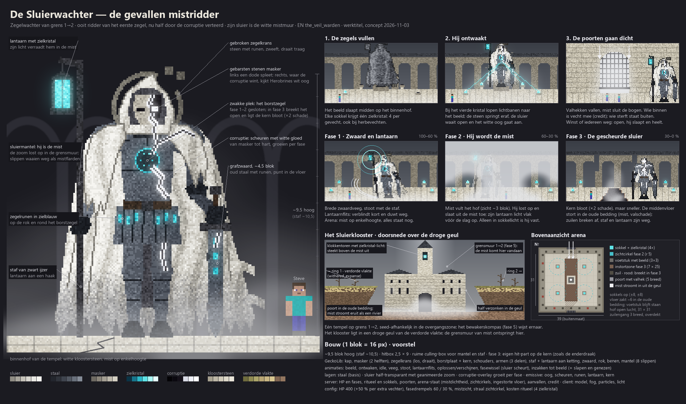
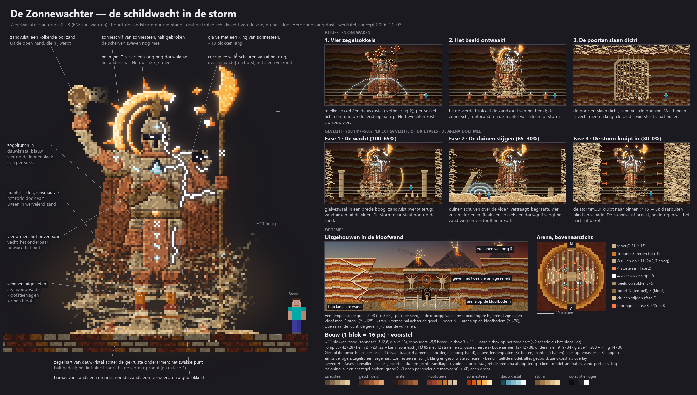
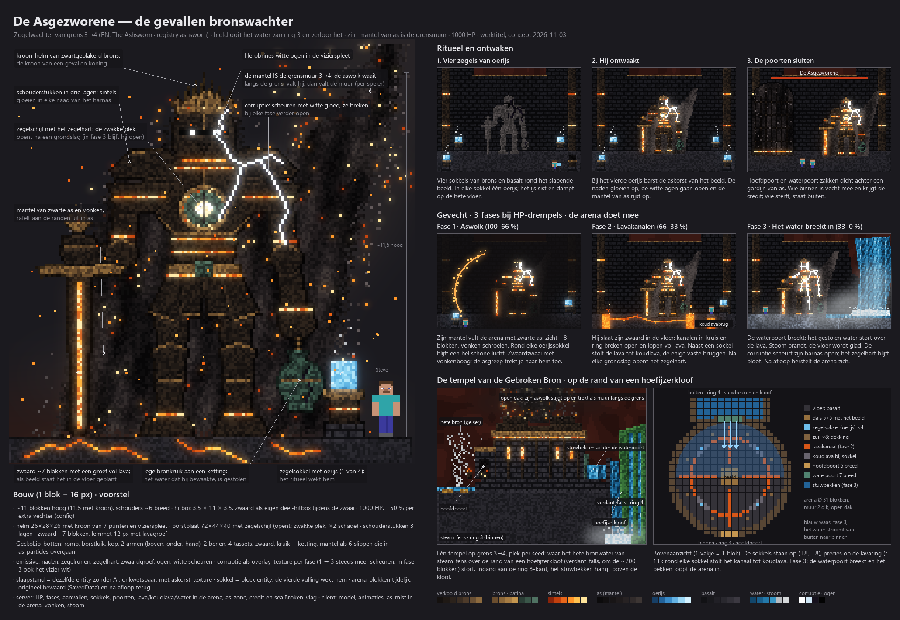
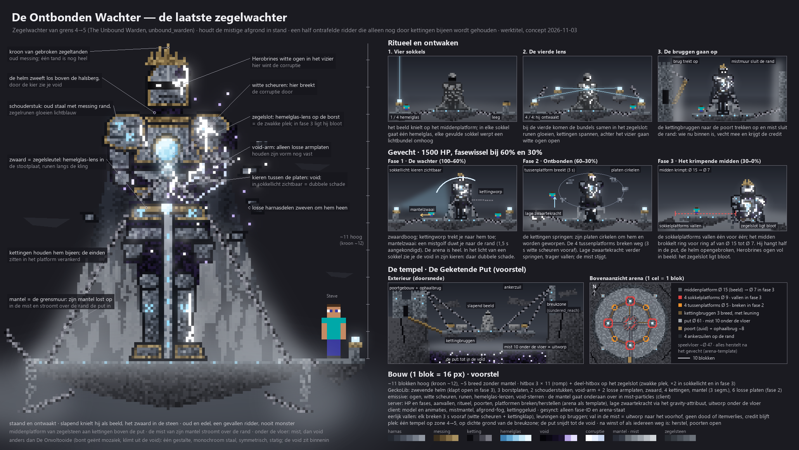

# Fase 4 — Zegelwachters (ringbewakers) en hun tempels

**Status:** sparring 2026-11-03; schetsen (conceptplaten) volgen in `docs/design/img/zegelwachter-grensN-<naam>.png`. Scope: `mobs` (wachters) en `structures` (tempels, naar voren gehaald uit fase 3).

## Rolverdeling
- **Nightmares** = Herobrines legioen, dreiging die jou vindt, optioneel (`fase-4-nightmares-concept.md`).
- **Zegelwachters** = poortwachters op een vaste plek; jij gaat naar hen toe. Verslaan is de progressie-eis voor de volgende ring.
- Herobrine blijft de enige die "persoonlijk" is.

## Beslissingen (sparring 2026-11-03)
1. **Identiteit:** oude zegelwachters van vóór de corruptie. Elk bewaakt het zegel van één grens (1→2, 2→3, 3→4, 4→5) en is half door de corruptie aangetast. Verslaan = het zegel breken; dat is lore-haak voor fase 5.
2. **Thema en kracht:** de wachter houdt de **grensmuur van zijn grens** in stand en vecht met dat element: 1→2 dichte witte mist, 2→3 wervelende zandstorm, 3→4 zwarte aswolk met vonken, 4→5 groene gifdamp → glitchruis (zie tabel; open). Versla hem en de muur valt weg (per speler; de muur zelf bouwt fase 5).
3. **Art direction:** oud en edel, half aangetast. Kolossale, statige wachters van steen/metaal met zegelrunen, harnas of mantel; de corruptie breekt erdoorheen (scheuren met witte gloed, Herobrines witte ogen waar de corruptie het wint). Elden Ring-niveau zoals de Nightmares, maar "gevallen ridder/beeld" in plaats van monster. Nooit schattig of speelgoedachtig.
4. **Slapen en wekken:** de wachter slaapt altijd in zijn tempel (als beeld). Hij ontwaakt via een **ritueel met 4 zegelsokkels** rond hem in de arena: in elke sokkel gaat één sleutelmateriaal van de Nether-ring van die ring (1→2 zielkristal, 2→3 dauwkristal, 3→4 oerijs, 4→5 hemelglas), dus 4 stuks; bij de vierde ontwaakt hij. Herbevechten kost opnieuw 4 stuks. De sokkels mogen in het gevecht meedoen.
5. **Gevecht:** echte poortbaas met **2–3 fases** (fasewissel bij HP-drempels), en **de arena doet mee** (zuilen breken, element stijgt, vloer valt weg e.d.).
6. **Arena sluit af:** bij het ontwaken gaan de poorten dicht; wie binnen is doet mee en krijgt de credit. Wie sterft staat buiten. Na winst, of als iedereen weg/dood is, gaan de poorten open; de wachter slaapt weer en is genezen.
7. **Sterkte:** tussen Nightmare N en N+1: richtwaarde **400 / 700 / 1000 / 1500 HP** (grens 1→2 … 4→5), +50% per extra vechter (zoals de Nightmares). Alles in de config.
8. **Beloning:** **alleen de grens openen** (per speler, voor iedereen die meevocht) plus XP; geen eigen drops, geen uniek item. Herbevechten dient om anderen te helpen.
9. **Tempels:** **precies één tempel per grens** (4 in totaal), elk een uniek ontwerp, ergens op zijn grens (seed-afhankelijke plek). Vinden is een tocht; het bewakerskompas (fase 5) wijst ernaar. Dit vervangt het besluit van 2026-09-30 (4 structures per grens).
10. **Fasevolgorde:** de tempels worden **nu in fase 4 volledig** ontworpen en gebouwd, samen met hun wachter (structure-werk naar voren gehaald), zodat arena en gevecht op elkaar passen.

## Haken in de bestaande wereld
| Grens | Muur (fase 1-ontwerp) | Sleutelmateriaal | Plek / terrein |
|---|---|---|---|
| 1→2 | dichte witte mist | zielkristal (Nether-1) | overgangszone `withered_expanse` (verdorde vlakte, vanilla → droog) |
| 2→3 | wervelende zandstorm | dauwkristal (Nether-2) | overgangszone `dry_riverbeds`; canyons → horizon-vulkanen, lucht slaat om naar asrood |
| 3→4 | zwarte aswolk met vonken | oerijs (Nether-3) | overgangszone `steam_fens` (bovenrand, ring 3) + `verdant_falls` (afdaling, ring 4, hoefijzerkloven om de ~700 blokken; verving de klif op 2026-10-15): het gestolen water stort naar beneden |
| 4→5 | volgens fase 1: groene gifdamp die overgaat in glitchruis (de "mistige afgrond" in beslissing 2 was een fout van main; keuze open) | hemelglas (Nether-4) | breukzone `sundered_reach` (~256 breed, ~75 % dichte grond, sinds V7-A geen afgrond meer): de wereld valt uit elkaar |

## Open (na de schetsen)
- Namen, uiterlijk en aanvallen per wachter; fases en arena-mechanics per tempel.
- Plaatsingsregel per tempel (afstand, terreineisen, gegarandeerd bereikbaar), ook in de Nether? (Nether-grensmuur bestaat ook.)
- Tempelopbouw rond de arena (alleen arena, of ook gangen/voorhof met vallen of mobs).
- Hoe het "openen van de grens" in fase 4 wordt vastgelegd zonder het grenssysteem van fase 5 (voorstel: per speler een vlag `sealBroken[N]` als attachment, fase 5 leest die).

## Schetsen (2026-11-03)
| Grens | Werktitel | Plaat | Kern |
|---|---|---|---|
| 1→2 | **De Sluierwachter** (`the_veil_warden`) |  | gevallen mistridder ~9,5 blok, sluiermantel = mist, lantaarn met zielkristal; fasen: zwaard/lantaarn → hij wordt de mist (alleen in sokkellicht vast) → sluier gescheurd, middenvloer stort in. Tempel: Sluierklooster half verzonken in een droge geul van `withered_expanse`, binnenhof 31×31 |
| 2→3 | **De Zonnewachter** (`sun_warden`) |  | vierarmige zandstenen schildwacht ~11 blok, gebroken zonneschijf, glaive van zonnesteen; fasen: de wacht → duinen stijgen, zuilen storten in, sokkel geeft dauwgolf → stormmuur kruipt naar binnen (r 15 → 8). Tempel: uitgehouwen in een kloofwand, arena Ø 31 op de kloofbodem |
| 3→4 | **De Asgezworene** (`ashsworn`) |  | zwartgeblakerde bronzen koning ~11 blok, lavazwaard, lege bronkruik (het gestolen water); fasen: aswolk (bellen rond de sokkels) → lavakanalen, koudlavabruggen bij de sokkels → het water breekt in (stoom, glad). Tempel van de Gebroken Bron: op de rand van een hoefijzerkloof (`steam_fens` → `verdant_falls`), arena Ø 31 |
| 4→5 | **De Ontbonden Wachter** (`unbound_warden`) |  | half ontrafelde ridder ~11 blok, door kettingen bijeen, void in de kieren, hemelglaslens als zegelslot; fasen: de wachter → platen cirkelen, tussenplatforms breken (3 s vooraf), lage zwaartekracht → sokkelplatforms vallen, midden krimpt Ø 15 → 7. Tempel De Geketende Put: platforms aan kettingen in een zelf uitgesneden put tot de void in de breukzone |
